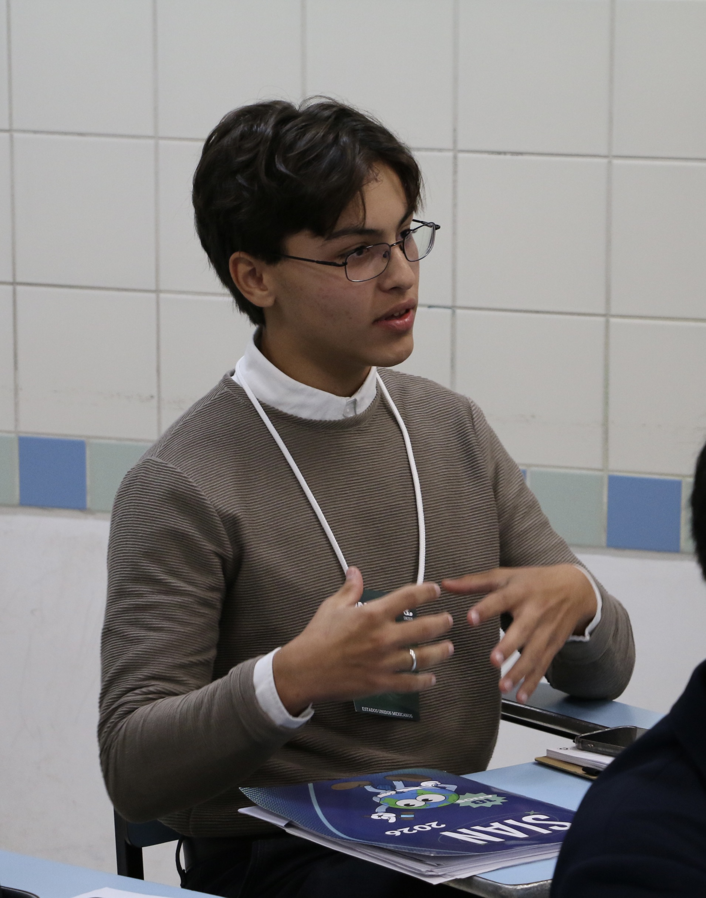

### Miguel Santos
##### Founder/CEO, [Roasted AI](https://www.instagram.com/roastedia/) | Independent Researcher 
---

---

I'm a 16-year-old Brazilian student building technology to solve problems I genuinely care about. It all started by looking at the software used in my father's grocery store and wondering how it could be better. That curiosity eventually grew into a passion for building products of my own.

> Inside me, I was thinking : "I can build something better."

Since then, I've developed a lasting interest in using technology to improve people's lives rather than simply making tasks faster. I'm especially interested in AI, education, neuroscience, and entrepreneurship.

I'm currently building Roasted, an AI-powered learning platform built around the Socratic method. Instead of providing immediate answers, it guides students through questions and feedback that encourage critical thinking, deeper understanding, and independent learning.

> Roasted AI | Uma aposta contra a atrofia. | Engineered for growth.

---
## Quick Facts

- 🇧🇷 Based in Brazil
- High school student (Class of 2027)
- Research interests: AI, Education & Neuroscience
- Founder of Roasted AI
- Currently learning Python, HTML and Web Development

---
### Currently Working On

| PROJECT  | TIME |
|----------|----------|
| [Roasted AI](https://www.instagram.com/roastedia/) | AI-powered Socratic tutor designed to teach students how to think rather than simply provide answers. |
|Sleapeee |Neuroscience-inspired platform helping users break the doomscrolling cycle and improve sleep habits.|
| Two Research papers | Researching AI, education, and student-machine interaction with university mentors.|
| Learning Python | Learning Python through project-based development and open-source repositories.|
| Learning HTML | Building better web applications through FreeCodeCamp and personal projects. |

---

### Selected Work

| Project | Description |
|---------|-------------|
| Roasted | AI tutor using the Socratic Method |
| Sleapeee | App that breaks the doomscrolling cycle |

Working toward launching each project while bootstrapping development with minimal resources.

---

### You can find me at

#####  [Instagram](https://www.instagram.com/migueloliveirasantos_/) | [X](https://x.com/mingueloliveira) | [Linkedin](https://www.linkedin.com/in/miguel-oliveira-santos-6a31a7353/) | Working on a portfolio website!
